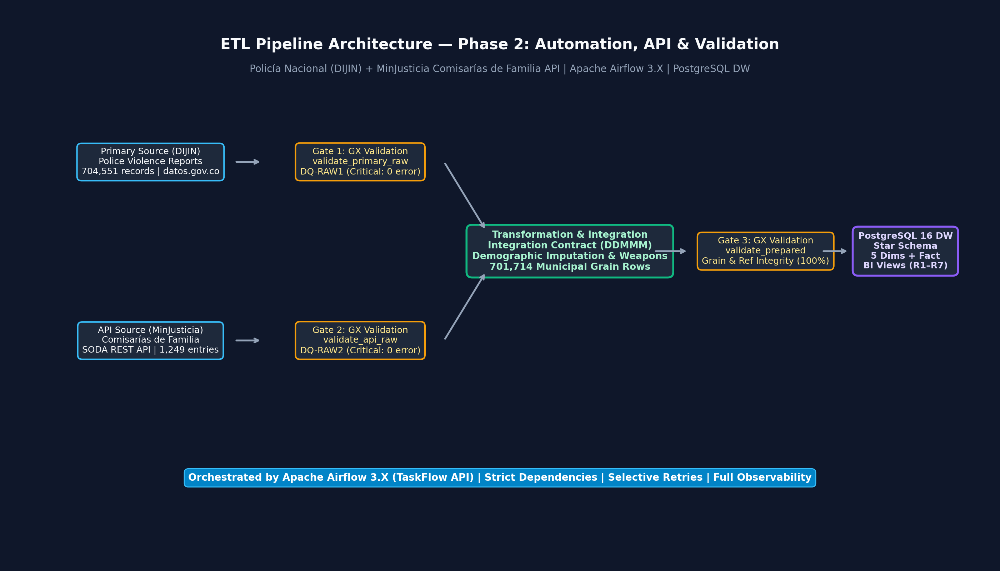
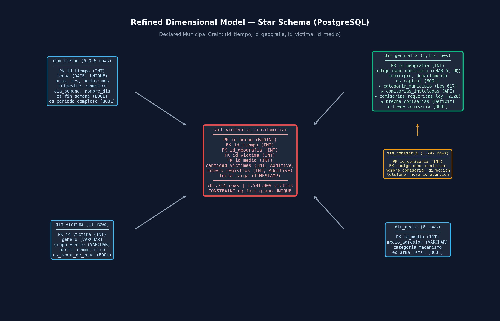

# ETL Project — Pipeline Automation, API Integration and Data Validation
## Second Delivery: From Data Engineering Baseline to an Operational Analytical System

**Academic Program:** Data Engineering and Artificial Intelligence  
**Faculty:** Engineering and Basic Sciences  
**Course:** ETL (G01) — Academic Period 2026-2  
**SDG Alignment:** SDG 5 (*Target 5.2 — Eliminate violence against women and girls*) and SDG 16 (*Target 16.1 — Reduce all forms of violence*)  
**Deliverable:** Independent Second Delivery GitHub Repository with complete orchestration, automated validation, and technical evidence.

---

## 1. Problem and Analytical Objective

### 1.1 Context and Problem Formulation
Domestic violence represents one of the most critical structural challenges in Colombia. In the First Delivery, analysis of police crime reports (Policía Nacional - DIJIN) revealed that registered victims grew from 23,171 in 2010 to 138,803 in 2025. However, crime reports alone measure only **reported volume**, which functions as a moving proxy heavily influenced by institutional presence and local reporting infrastructure rather than true underlying incidence.

The Second Delivery tackles this fundamental analytical limitation by integrating a second data source: the **National Directory and Characterization of Comisarías de Familia** (Ministerio de Justicia y del Derecho), extracted programmatically via SODA REST API. This integration bridges the gap between crime occurrence and institutional protection capacity, answering:

> *¿Cuál es la sobrecarga operativa real que enfrentan las Comisarías de Familia en Colombia frente al volumen de violencia intrafamiliar reportado, y dónde existe un déficit legal de infraestructura (Ley 2126 de 2021) que coincide críticamente con ataques letales contra menores de edad y mujeres?*

### 1.2 Engineering Objective
Evolve the Phase 1 analytical baseline into an automated, observable, and resilient data engineering system by:
1. Programmatically acquiring and profiling both primary and REST API sources.
2. Automating quality gates using **Great Expectations 1.X** for raw branches and prepared layers.
3. Formulating and answering integrated analytical requirements **R6** and **R7**.
4. Refining the dimensional Data Warehouse schema in **PostgreSQL 16**.
5. Orchestrating the end-to-end workflow with **Apache Airflow 3.X** using the TaskFlow API (`@dag`, `@task`).
6. Enforcing and proving reliability across **Test A (Successful Run)**, **Test B (Controlled Critical Failure)**, and **Test C (Safe Rerun & Idempotency)**.

---

## 2. First Delivery Baseline and Repository Link

* **Baseline Repository (Delivery 1):** [https://github.com/michaelmaccardona-lgtm/Proyecto_etl_c1](https://github.com/michaelmaccardona-lgtm/Proyecto_etl_c1)
* **Local Reference Folder:** `Proyecto_etl_C1/` (kept intact as historical evidence, with documentation consolidated in `docs_proyecto_1/`).
* **Línea Base Dimensional:** PostgreSQL star schema with 4 dimensions (`dim_tiempo`, `dim_geografia`, `dim_victima`, `dim_medio`) and transaction fact table `fact_violencia_intrafamiliar` (701,714 fact rows representing 1,501,809 victims).
* **Documented Limitation in Delivery 1:** Absence of institutional capacity and statutory population thresholds. The model measured volume, but could not identify institutional overload or legal deficits.

---

## 3. Status and Changes for Requirements R1–R5

| Requirement | Status | Change Introduced | Justification | Second Delivery Analytical Output |
| :---: | :---: | :---: | :---: | :---: |
| **R1** | **Maintained** | None (Preserved `es_periodo_completo`). | Multi-year YoY growth requires dense calendar; partial year 2026 is excluded from rate calculations. | Annual victim series (2010–2026), YoY growth rates, and quantification of the 2020 lockdown plateau (+1.93%). |
| **R2** | **Maintained** | Geography dimension enriched with institutional indicators. | National ranking and capital city concentration remain foundational to understand territorial burden. | Department/municipality rankings; verifies 63.99% concentration in departmental capitals. |
| **R3** | **Maintained** | Preserved explicit demographic cohorts and child flag. | Gender and life stage disparities underpin SDG 5.2. | Disaggregation confirming 77.33% female victims (1,161,392) and 93,986 children/adolescents. |
| **R4** | **Maintained** | Harmonized blade weapons and mechanism categories. | Lethality filtering is required to isolate lethal weapon violence. | Weapon category distribution, lethality flag, and victims-per-report ratio (2.59 for unarmed violence). |
| **R5** | **Refined** | Municipal minor lethal-weapon victims feed directly into R7 prioritisation. | Connecting lethal attacks on minors with institutional deficits provides actionable intervention targets. | Ranking of municipalities with lethal weapon attacks against minors, serving as the severity numerator for R7. |

---

## 4. New Integrated Analytical Requirements R6 and R7

| ID | Analytical Requirement | Primary-Source Data Required | API Data Required | Integration Strategy / Key | Expected KPI or Measure | Required Level of Detail |
| :---: | :---: | :---: | :---: | :---: | :---: | :---: |
| **R6** | **Institutional Workload & Saturation per Comisaría de Familia** | `cantidad_victimas`, `numero_registros`, `codigo_dane_municipio` | `existencia_de_comisarias`, `categoria_municipio` | Equi-join on 5-digit DANE code (`codigo_dane_municipio`) | `tasa_carga_victimas_por_comisaria` = `SUM(victimas) / comisarias_instaladas`. Classification: Crítica (>2k), Alta (1k–2k), Moderada (<1k). | Municipality grain (`dim_geografia`), annual rollup. |
| **R7** | **Statutory Institutional Deficit (Ley 2126) vs Severe Child & Gender Vulnerability** | `cantidad_victimas` filtered by `es_menor_de_edad AND es_arma_letal` (R5) and `genero = 'FEMENINO'` (R3) | `comisarias_ley_2126_100_000`, `existencia_de_comisarias`, `categoria_municipio` | Multi-attribute join on `codigo_dane_municipio` with conditional prioritization logic | `brecha_comisarias` = `max(0, requeridas - instaladas)` and `indice_prioridad_intervencion` (Prioridad 1 Urgente, Prioridad 2 Alta). | Municipality and Municipal Category (Ley 617). |

---

## 5. Primary Source and API Source

### 5.1 Primary Source
* **Dataset:** Reporte Delito Violencia Intrafamiliar — Policía Nacional (DIJIN)
* **Platform:** Portal de Datos Abiertos del Estado Colombiano (`datos.gov.co`)
* **Endpoint:** `https://www.datos.gov.co/api/views/vuyt-mqpw/rows.csv?accessType=DOWNLOAD`
* **Format & Volume:** CSV, UTF-8, 65.6 MB, 704,551 records, 1,501,809 victims, 8 native attributes.
* **Extraction:** Programmatic acquisition with SHA-256 validation pinned in `data/raw/primary_source_manifest.json`.

### 5.2 API Source
* **Provider:** Ministerio de Justicia y del Derecho / Presidencia de la República
* **Dataset:** Caracterización de las Comisarías de Familia en el Territorio Nacional
* **Platform:** SODA REST API on `datos.gov.co`
* **Endpoint:** `https://www.datos.gov.co/resource/7tuu-upb2.json`
* **Format & Volume:** JSON REST API, 1,249 entries covering 1,102 municipalities, 15 attributes.
* **Operational Parameters:** `$limit=2000`, `$offset`, `$order=:id`, timeout=30s, exponential backoff retries.
* **Authentication:** Public endpoint with optional `X-App-Token` via `API_APP_TOKEN` in `.env`.
* **Raw Persistence:** Pinned payload saved to `data/raw/api_comisarias_raw.json` with hash recorded in `data/raw/api_source_manifest.json`.

---

## 6. Analytical Value Contributed by the API

1. **Revealing Hidden Institutional Overload (R6):**
   In absolute terms, Bogotá registers the most victims (433,697) across 39 comisarías (11,120 víctimas/comisaría). However, the API reveals that intermediate cities suffer an even more extreme collapse in operational capacity:
   * **Cúcuta:** 20,389 víctimas registradas con **1 sola comisaría instalada** (20,389 víctimas/comisaría).
   * **Popayán:** 17,070 víctimas con **1 sola comisaría** (17,070 víctimas/comisaría).
   * **Bello:** 16,984 víctimas con **1 sola comisaría** (16,984 víctimas/comisaría).
   * **Floridablanca:** 10,192 víctimas con **1 sola comisaría** (10,192 víctimas/comisaría).

2. **Targeting Legal Deficit to Protect Minors and Women (R7):**
   * Under **Ley 2126 de 2021**, municipalities must have at least 1 Comisaría de Familia per 100,000 inhabitants.
   * **Cúcuta** has a statutory deficit of **8 comisarías** (requires 9, has 1) and registers **51 minors attacked with lethal weapons** (Rank 1 Urgency).
   * **Soacha** has a deficit of **6 comisarías** (requires 9, has 3) and 27 minors attacked with lethal weapons.
   * **Montería** has a deficit of **5 comisarías** (requires 6, has 1) and 41 minors attacked with lethal weapons.
   * Across Colombia, **114 comisarías de familia faltan por construir** para cumplir la ley, concentrándose el 58% del déficit en municipios de Categoría 1 y Categoría Especial.

---

## 7. System Architecture

```text
  [Primary Source]                          [API Source]
Policía Nacional DIJIN                MinJusticia Comisarías
  (704,551 records)                      (1,249 records)
          │                                      │
          ▼                                      ▼
   extract_primary                         extract_api
          │                                      │
          ▼                                      ▼
[validate_primary_raw]                  [validate_api_raw]
Great Expectations Gate 1              Great Expectations Gate 2
 (DQ-RAW1-01 to 05)                     (DQ-RAW2-01 to 04)
          │                                      │
          └──────────────────┬───────────────────┘
                             │
                             ▼
              [transform_and_clean_and_integrate]
              - DANE 5-Digit Rollup (DDMMM)
              - Weapon Harmonisation & Lethality
              - Demographic Imputation
              - Geographic Integration Contract
              - Fact Grain Aggregation (701,714 rows)
                             │
                             ▼
                    [validate_prepared]
                 Great Expectations Gate 3
               - Declared Grain Uniqueness
               - Referential Integrity (0 Orphans)
               - Exact Measure Reconciliation
                             │
                             ▼
                    [load_dimensional_dw]
                 PostgreSQL 16 Data Warehouse
               - Fast Bulk COPY Protocol
               - Foreign Key & Check Constraints
               - Semantic Views (vw_bi_hechos_completos)
                             │
                             ▼
                 [BI Analytical Dashboard]
                 Connected to PostgreSQL DW
                 Interactive R1–R7 Visualisations
```



---

## 8. Data Profiling Findings

Full profiling evidence generated automatically in [`docs/evidence/profiling_evidence.json`](docs/evidence/profiling_evidence.json) and executed in [`notebooks/profiling_and_validation.ipynb`](notebooks/profiling_and_validation.ipynb).

| # | Source | Attribute / Domain | Profiling Finding | Potential Quality Risk | Mitigation in Pipeline |
| :-: | :---: | :--- | :--- | :--- | :--- |
| 1 | Primary | `CODIGO DANE` | 2,397 distinct 8-digit codes reaching *centro poblado* level. | Rolled up blindly, records split across sub-municipal keys. | Truncated to 5 digits (`DDMMM`); collapses 2,837 rows to municipal grain. |
| 2 | Primary | `CANTIDAD` | Range 1–198; 0 non-positive; 0 nulls; mean 2.13. Total: 1,501,809. | Outliers could distort averages if not treated as additive sums. | Reconciled at pre-load, post-transform, and post-load gates. |
| 3 | API | `c_digo_dane_municipio` | Text codes with length 4 (e.g. `5088`) and 5 (e.g. `11001`). 114 codes missing leading zero. | Leading zeros lost if read as integer; join fails. | Formatted strictly with `.str.strip().str.zfill(5)`. |
| 4 | API | `categoria_municipio` | Categorías 1–6, `ESP`, plus 17 null values. | Unhandled null categories in dimension drill-downs. | Standardized `ESP` → `ESPECIAL`, imputed `NO REPORTADA`. |
| 5 | Cross | `codigo_dane_municipio` | 1,100 municipalities match (98.92% coverage). 12 primary codes and 2 API codes unmatched. | Unmatched records could drop victims or break FK constraints. | Left outer join contract: non-municipalized areas get default baseline; API municipalities added to `dim_geografia`. |

---

## 9. Quality Risks and Quality Rules

| Rule ID | Layer | Attribute(s) | Quality Dimension | Quality Rule | Metric / Threshold | Severity | Related Req |
| :---: | :---: | :--- | :--- | :--- | :--- | :---: | :---: |
| **DQ-RAW1-01** | Raw Primary | Schema / Columns | Completeness | Mandatory columns must exist in raw extract. | Missing cols = 0 | **Critical** | R1–R5 |
| **DQ-RAW1-02** | Raw Primary | `FECHA HECHO` | Validity & Format | Incident date matches `DD/MM/YYYY` format. | Parseable = 100% | **Critical** | R1 |
| **DQ-RAW1-03** | Raw Primary | `CODIGO DANE` | Format & Length | DANE code is 8-character string. | Length == 8 for >= 99.99% | **Critical** | R2, R5 |
| **DQ-RAW1-04** | Raw Primary | `CANTIDAD` | Validity & Range | Measure CANTIDAD must be positive integer >= 1. | Value >= 1 for 100% | **Critical** | R1–R5 |
| **DQ-RAW1-05** | Raw Primary | `GENERO` | Completeness | Unreported gender must not exceed 1% of extract. | Nulls <= 1.0% | **Warning** | R3 |
| **DQ-RAW2-01** | Raw API | Schema / Columns | Completeness | Mandatory API attributes present in payload. | Missing cols = 0 | **Critical** | R6, R7 |
| **DQ-RAW2-02** | Raw API | `c_digo_dane_municipio` | Validity | DANE code length between 4 and 5 characters. | Valid for 100% | **Critical** | R6, R7 |
| **DQ-RAW2-03** | Raw API | `categoria_municipio` | Domain Validity | Municipal category belongs to legal set (1–6, ESP). | Unexpected <= 2.0% | **Warning** | R7 |
| **DQ-RAW2-04** | Raw API | `existencia_de_comisarias` | Validity & Range | Verified comisarías count must be >= 0. | Value >= 0 for >= 90% | **Critical** | R6, R7 |
| **DQ-PREP-01** | Prepared | Grain Columns | Uniqueness | Declared grain uniqueness in fact table. | Duplicates = 0 | **Critical** | R1–R7 |
| **DQ-PREP-02** | Prepared | Foreign Keys | Completeness | Foreign keys must not be null in fact table. | Null FKs = 0 | **Critical** | R1–R7 |
| **DQ-PREP-03** | Prepared | Foreign Keys | Referential Integrity | All fact foreign keys exist in dimensions. | Orphan FKs = 0 | **Critical** | R1–R7 |
| **DQ-PREP-04** | Prepared | `comisarias_instaladas` | Range | Installed comisarías count non-negative. | Value >= 0 for 100% | **Critical** | R6, R7 |
| **DQ-PREP-05** | Prepared | `cantidad_victimas` | Reconciliation | Loaded victims match raw extract total exactly. | Delta = 0 | **Critical** | All |

---

## 10. Great Expectations Design and Rule Traceability

* **GX Version:** 1.24.0 (Fluent DataContext API).
* **Implementation:** `src/validate_gx.py`.
* **Execution Evidence:** JSON execution results saved automatically in `docs/evidence/` with timestamped and latest pointers.
* **Severity Enforcement:**
  * **Critical:** Raises `ValidationError`. In Airflow, task fails with exit code 1; downstream dependencies are immediately marked `UPSTREAM_FAILED` and aborted.
  * **Warning:** Logs details, records unexpected counts/indices, and allows normal continuation.

---

## 11. Raw Validation Design for Both Sources

* **Primary Branch:** `extract_primary` → `validate_primary_raw`.
  Evaluates raw extract directly before any transformation touches the data.
* **API Branch:** `extract_api` → `validate_api_raw`.
  Evaluates raw SODA API JSON payload.
* **Independent Observability:** Each branch runs independently in Airflow. Failure in one raw branch halts the pipeline before transformation, avoiding partial processing.

---

## 12. Transformation Strategy and Integration Contract

### 12.1 Transformation Decisions
1. **DANE Truncation:** Truncated from 8 digits to 5 digits (`DDMMM`) to conform to the declared municipal grain.
2. **Canonical Names:** Municipality name mapped to the modal name for that code; stripped `(CT)` into boolean `es_capital`.
3. **Weapon Harmonisation:** 4 raw blade weapon categories collapsed into `ARMA BLANCA` (`ARMAS BLANCAS`).
4. **Demographic Imputation:** Missing gender (0.48%) and age groups (0.20%) imputed as `NO REPORTADO`. **0 victims dropped**.

### 12.2 Integration Contract
* **Integration Key:** 5-digit DANE code (`codigo_dane_municipio`).
* **Cardinality:** 1:1 at the municipal grain (API directory aggregated from 1,249 entries to 1,113 municipalities).
* **Unmatched Primary Records:** 11 non-municipalized areas (corregimientos departamentales en Amazonas, Vaupés, Guainía) and 1 non-specified record receive baseline statutory defaults (`comisarias_instaladas = 0`, `brecha = 1`, `categoria = 'ÁREA NO MUNICIPALIZADA'`).
* **API-Only Municipalities:** 2 municipalities (Carmen del Darién `27150` and Barrancominas `94343`) with 0 historical police reports added to `dim_geografia` with 0 fact rows, guaranteeing total referential integrity.
* **Assumptions:** Ley 2126 statutory requirement requires 1 comisaría per 100,000 inhabitants.

---

## 13. Refined Dimensional Model and Change Justification



### 13.1 Changes from Delivery 1
1. **`dim_geografia` Enriched:** Added attributes `categoria_municipio`, `comisarias_instaladas`, `comisarias_requeridas_ley`, `brecha_comisarias`, and `tiene_comisaria`.
   * *Justification:* Supports R6 and R7 directly through star schema joins without requiring changes to the fact table grain or creating snowflake complexity.
2. **`dim_comisaria` Added (Outrigger):** Contains 1,247 physical comisarías with name, address, telephone, schedule, and category.
   * *Justification:* Supports operational drill-downs and geospatial mapping while keeping `dim_geografia` at the municipal grain.
3. **`fact_violencia_intrafamiliar` Preserved:** Declared municipal grain `(id_tiempo, id_geografia, id_victima, id_medio)` strictly preserved with unique constraint `uq_fact_grano`.

---

## 14. Prepared Data Validation

Executed at **Gate 3 (`validate_prepared`)** prior to Data Warehouse loading:
1. Uniqueness of grain combination `(id_tiempo, id_geografia, id_victima, id_medio)`.
2. Zero null foreign keys in the fact table.
3. Referential integrity: Fact FKs verified against PKs of all 4 dimensions.
4. Exact measure reconciliation against source extract manifests.

---

## 15. Data Warehouse Implementation and Load

* **Engine:** PostgreSQL 16 Alpine running in Docker container `etl_c2_postgres_dw`.
* **DDL Definition:** `sql/create_dw.sql`.
* **Loading Mechanism:** Fast streaming bulk COPY via `psycopg2.copy_expert` with CSV formatting and quote escaping.
* **Load Performance:** 701,714 fact rows loaded in **16.8 seconds**.
* **Automated Reconciliation Report (`docs/evidence/reconciliation_report.json`):**
  * Expected Source Records: 704,551 | Loaded: 704,551 | Delta: **0**
  * Expected Source Victims: 1,501,809 | Loaded: 1,501,809 | Delta: **0**
  * Orphan Foreign Keys: **0**
  * Exact Reconciliation Pass: **TRUE**

---

## 16. Airflow DAG Design and Task Interfaces

* **DAG File:** `dags/etl_violencia_intrafamiliar_dag.py`.
* **Authoring Interface:** Airflow 3.X TaskFlow API (`@dag`, `@task`).
* **Task Interfaces (No Bulk XCom):**
  * Tasks pass small JSON dictionaries containing file paths, checksums, and record counts.
  * Extracted and prepared datasets are persisted on disk (`data/raw/*.csv`, `data/processed/*.parquet`).
* **Task Sequence:**
  `extract_primary` → `validate_primary_raw`  
  `extract_api` → `validate_api_raw`  
  Convergence: `transform_and_clean_and_integrate` → `validate_prepared` → `load_dimensional_dw`.

---

## 17. Failure and Retry Policies

| Failure Class | Example | Task / Scope | Retry Configuration | Rationale |
| :--- | :--- | :--- | :--- | :--- |
| **Transient Operational** | API timeout, network drop | `extract_api` | `retries=3, retry_delay=10s, exponential backoff` | Temporary network issues typically resolve on subsequent attempts. |
| **Transient Database** | Connection pool contention | `load_dimensional_dw` | `retries=1, retry_delay=5s` | Transient DB socket readiness recovers quickly. |
| **Deterministic Data Quality** | Missing mandatory column, grain duplicate | `validate_*_raw`, `validate_prepared` | `retries=0` (Fail Fast) | Repeating deterministic violations reproduces the error. Immediate halt prevents pipeline corruption. |

---

## 18. Successful-Run Evidence (Test A)

* **Evidence File:** [`docs/evidence/test_a_successful_run.json`](docs/evidence/test_a_successful_run.json).
* **Total Execution Duration:** 19.63 seconds.
* **Audit Summary:**
  * `extract_primary`: 704,551 rows extracted.
  * `validate_primary_raw`: Gate 1 passed (0 critical errors).
  * `extract_api`: 1,249 entries retrieved from SODA REST API.
  * `validate_api_raw`: Gate 2 passed (0 critical errors).
  * `transform_and_clean_and_integrate`: 701,714 fact rows constructed.
  * `validate_prepared`: Gate 3 passed (100% referential integrity, 0 grain duplicates).
  * `load_dimensional_dw`: Loaded into PostgreSQL; 1,501,809 victims verified.

---

## 19. Controlled-Failure Evidence (Test B)

* **Evidence File:** [`docs/evidence/test_b_controlled_failure.json`](docs/evidence/test_b_controlled_failure.json).
* **Controlled Condition Injected:** Dropped mandatory column `existencia_de_comisarias` from incoming API payload.
* **Observed Pipeline Behavior:**
  1. `extract_primary` and `extract_api` completed.
  2. `validate_api_raw` detected Critical violation of rule **DQ-RAW2-01** (Schema Completeness) and failed with `ValidationError`.
  3. Downstream tasks `transform_and_clean_and_integrate`, `validate_prepared`, and `load_dimensional_dw` were marked **`BLOCKED (UPSTREAM_FAILED)`** and never executed.
  4. The PostgreSQL Data Warehouse remained completely protected from corrupted data.

---

## 20. Repeatability and Safe-Rerun Strategy (Test C)

* **Evidence File:** [`docs/evidence/test_c_safe_rerun.json`](docs/evidence/test_c_safe_rerun.json).
* **Idempotency Strategy:** Atomic transactional DDL re-creation and bulk COPY guarded by `CONSTRAINT uq_fact_grano UNIQUE (id_tiempo, id_geografia, id_victima, id_medio)`.
* **Before & After Rerun Comparison:**
  * Fact Rows Before: 701,714 | After: 701,714 | Delta: **0**
  * Total Victims Before: 1,501,809 | After: 1,501,809 | Delta: **0**
  * Total Source Records Before: 704,551 | After: 704,551 | Delta: **0**
  * Silent Duplicates Detected: **FALSE** (100% Idempotent).

---

## 21. Dashboard and Analytical Outputs

* **Dashboard Technology:** Interactive Web Application (HTML5, Vanilla CSS, Chart.js).
* **Location:** `dashboard/index.html`.
* **To launch:** Run `python3 dashboard/server.py` and open [http://localhost:8080](http://localhost:8080).
* **Analytical Views:**
  * **Resumen Ejecutivo:** KPIs reconciliados y comparativa general.
  * **R6: Carga Institucional:** Gráfico de barras horizontales de víctimas por comisaría y ranking de sobrecarga crítica.
  * **R7: Brecha Ley 2126:** Gráfico de dispersión (burbujas) cruzando déficit de comisarías con menores atacados con armas letales, y resumen por categoría municipal Ley 617.
  * **Línea Base R1–R5:** Gráficos temporales, departamentales, demográficos y de mecanismos.
  * **Trazabilidad y Calidad:** Resumen en vivo de las 3 compuertas GX y resultados de pruebas A, B y C.

---

## 22. Requirement-to-KPI and End-to-End Traceability Matrix

| Requirement | Primary Attribute | API Attribute | Profiling Finding | Quality Rule | GX Check | Transformation / Integration | DW Target | Final KPI / Visualisation |
| :---: | :--- | :--- | :--- | :--- | :--- | :--- | :--- | :--- |
| **R1** | `FECHA HECHO`, `CANTIDAD` | N/A | Dense daily series (6,056 days); 2026 partial. | DQ-RAW1-02, DQ-RAW1-04 | `ExpectColumnValuesToMatchRegex` | ISO date parse; derive `es_periodo_completo`. | `dim_tiempo.anio`, `fact.cantidad_victimas` | Serie anual y tasa de crecimiento YoY excluyendo 2026. |
| **R2** | `CODIGO DANE`, `MUNICIPIO` | N/A | 2,397 sub-municipal codes; 64 duplicate names. | DQ-RAW1-03 | `ExpectColumnValueLengthsToBeBetween` | Rollup to 5 digits (`DDMMM`); strip `(CT)` into `es_capital`. | `dim_geografia.es_capital` | Ranking departamental y % de concentración en capitales. |
| **R3** | `GENERO`, `GRUPO ETARIO` | N/A | Nulls in gender (0.48%) and age group (0.20%). | DQ-RAW1-05 | `ExpectColumnValuesToNotBeNull(mostly=0.99)` | Impute `NO REPORTADO`; derive `es_menor_de_edad`. | `dim_victima.perfil_demografico` | Distribución de víctimas por cohorte y proporción de mujeres. |
| **R4** | `ARMAS MEDIOS`, `CANTIDAD` | N/A | 4 blade weapon labels; unarmed violence highest volume. | DQ-RAW1-04 | `ExpectColumnValuesToBeBetween(min=1)` | Harmonise labels; derive `categoria_mecanismo`. | `dim_medio.categoria_mecanismo` | Proporción por mecanismo y ratio víctimas por denuncia. |
| **R5** | `CODIGO DANE`, `ARMAS MEDIOS` | N/A | 3,035 minors attacked with lethal weapons. | DQ-RAW1-03, DQ-RAW1-04 | Grain check | Combine minor flag and lethality filter. | `fact` joined with `dim_victima` and `dim_medio` | Hotspots municipales de agresiones letales contra menores. |
| **R6** | `CANTIDAD`, `CODIGO DANE` | `existencia_de_comisarias` | Codes with 4-5 digits; 1,102 distinct municipalities. | DQ-RAW2-02, DQ-RAW2-04 | `ExpectColumnValueLengthsToBeBetween` | Zero-pad DANE to 5 digits; aggregate installed count. | `dim_geografia.comisarias_instaladas` | **Tasa de víctimas por comisaría instalada (Ranking sobrecarga)**. |
| **R7** | `CANTIDAD` (R3, R5 filters) | `comisarias_ley_2126`, `categoria_municipio` | Deficit in 114 municipalities; concentrated in Cat 1/ESP. | DQ-RAW2-01, DQ-PREP-04 | `ExpectTableColumnsToMatchSet` | Calculate `max(0, req - inst)`; derive priority index. | `dim_geografia.brecha_comisarias` | **Matriz de Intervención Urgente (Déficit Legal vs Letalidad Menores)**. |

---

## 23. Setup and Execution Instructions

### 23.1 Prerequisites
* Python 3.10+
* Docker & Docker Compose (or local PostgreSQL 16)

### 23.2 Step-by-Step Run
```bash
# 1. Clone repository and navigate to folder
cd Proyecto_etl_C2

# 2. Configure environment
cp .env.example .env

# 3. Start PostgreSQL Data Warehouse container
docker compose up -d

# 4. Install python dependencies
python3 -m pip install -r requirements.txt

# 5. Run full pipeline and all reliability tests (A, B, C)
python3 src/run_pipeline.py

# 6. Launch interactive BI dashboard
python3 dashboard/server.py
# Open browser at http://localhost:8080
```

---

## 24. Assumptions and Limitations

1. **Denuncias Policiales vs Incidencia:** Los datos reflejan violencia intrafamiliar registrada por la Policía Nacional. Los cambios históricos también reflejan variaciones en la propensión y capacidad institucional de denuncia.
2. **Corte Temporal Parcial:** El extracto finaliza el 31 de julio de 2026; comparaciones anuales deben filtrar `es_periodo_completo = TRUE`.
3. **Población en Ley 2126:** La exigencia legal de comisarías reportada por el Ministerio de Justicia asume escalones de 100.000 habitantes.
4. **Áreas No Municipalizadas:** 11 corregimientos departamentales en la Amazonía no disponen de administración municipal bajo Ley 617; fueron imputados con valores por defecto documentados para no descartar víctimas.
5. **Idempotencia:** La recarga atómica reconstruye las estructuras asegurando cero duplicados sin pérdida de trazabilidad.

---

## 25. Team Members and Responsibilities

* **Course:** ETL (G01) — Academic Period 2026-2
* **Delivery 2 Repository:** [https://github.com/Macowli-0611/Proyecto_etl_c2](https://github.com/Macowli-0611/Proyecto_etl_c2)

| Team Member | Core Responsibilities in Second Delivery |
| :--- | :--- |
| **Michael Macowli Cardona Rodríguez** | Formulation of R6 and R7; Apache Airflow DAG design; integration contract; repository architecture and end-to-end orchestration. |
| **Sebastián Manrique Mejía** | SODA REST API extraction; cross-source profiling; Great Expectations validation suites (Gate 1, Gate 2, Gate 3). |
| **David Hernández Paz** | Dimensional model refinement (`dim_geografia` enrichment, `dim_comisaria`); PostgreSQL 16 DDL; bulk load and automated reconciliation. |
| **Sebastián Torres Pantoja** | Business Intelligence semantic layer; analytical SQL queries for R1–R7; interactive web dashboard development and reliability testing. |
