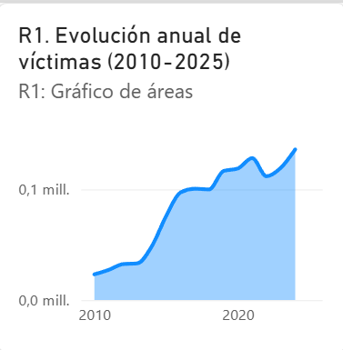
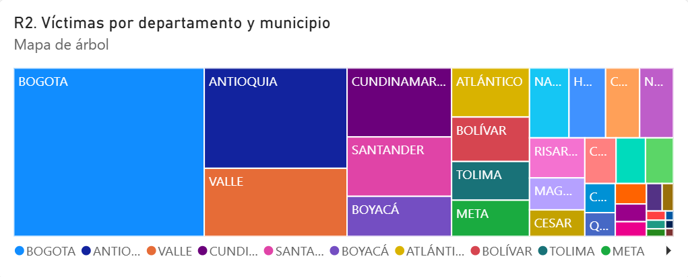
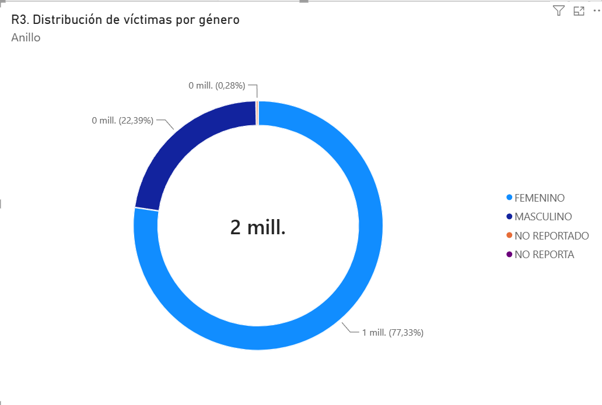
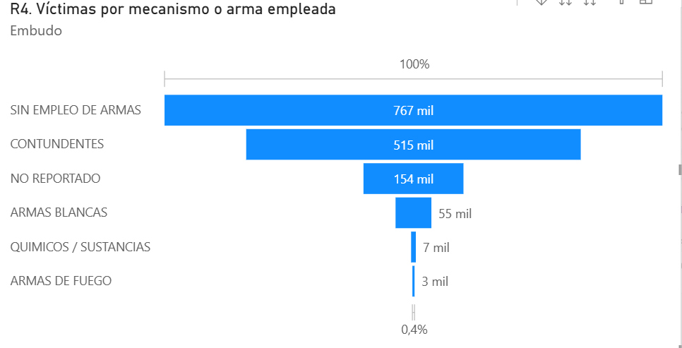
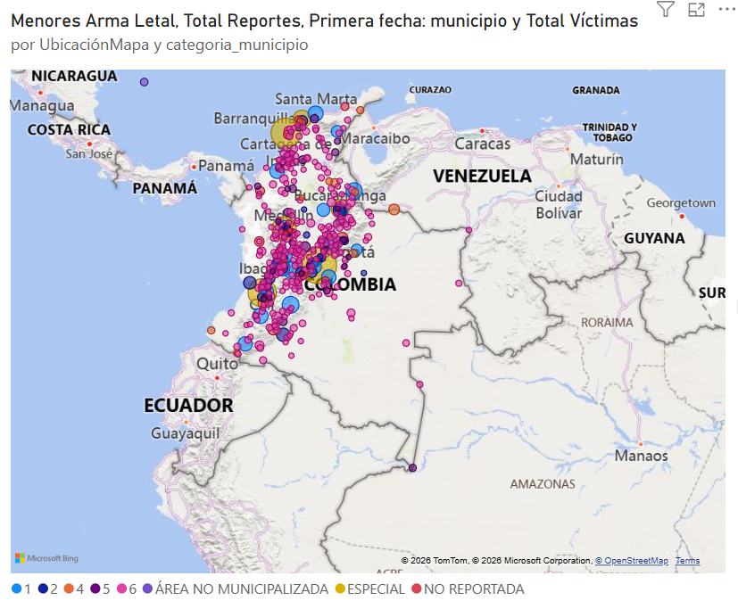
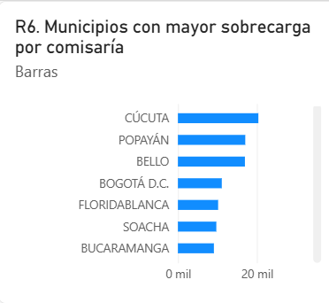
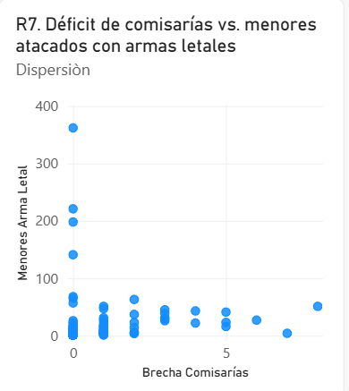

# ETL Project — Pipeline Automation, API Integration and Data Validation
## Second Delivery: From Data Engineering Baseline to an Operational Analytical System

**Academic Program:** Data Engineering and Artificial Intelligence  
**Faculty:** Engineering and Basic Sciences  
**Course:** ETL (G01) — Academic Period 2026-2  
**SDG Alignment:** SDG 5 (*Target 5.2 — Eliminate violence against women and girls*) and SDG 16 (*Target 16.1 — Reduce all forms of violence*)  
**Deliverable:** Independent Second Delivery GitHub repository with complete orchestration, automated validation, and technical evidence.

> **Language note:** This documentation is written in English. Column, table and field names (e.g. `CODIGO DANE`, `cantidad_victimas`, `existencia_de_comisarias`) are kept in Spanish exactly as they appear in the Colombian government datasets and in the Data Warehouse.

---

## 1. 🎯 Problem and Analytical Objective

### 1.1 Context and Problem Formulation
Domestic violence is one of the most critical structural challenges in Colombia. In the First Delivery, the analysis of police crime reports (Policía Nacional - DIJIN) showed that registered victims grew from 23,171 in 2010 to 138,803 in 2025. However, crime reports only measure **reported volume**, a moving proxy that is heavily influenced by institutional presence and local reporting infrastructure rather than by the true underlying incidence.

The Second Delivery addresses this analytical limitation by integrating a second data source: the **National Directory and Characterization of Comisarías de Familia** (Ministerio de Justicia y del Derecho), extracted programmatically through a SODA REST API. This integration bridges the gap between crime occurrence and institutional protection capacity, and answers the following question:

> *What is the real operational overload faced by the Comisarías de Familia in Colombia relative to the reported volume of domestic violence, and where does a legal infrastructure deficit (Ley 2126 de 2021) critically coincide with lethal attacks against minors and women?*

### 1.2 Engineering Objective
Evolve the Phase 1 analytical baseline into an automated, observable and resilient data engineering system by:
1. Programmatically acquiring and profiling both the primary source and the REST API source.
2. Automating quality gates with **Great Expectations 1.X** for the raw branches and the prepared layer.
3. Formulating and answering the integrated analytical requirements **R6** and **R7**.
4. Refining the dimensional Data Warehouse schema in **PostgreSQL 16**.
5. Orchestrating the end-to-end workflow with **Apache Airflow** using the TaskFlow API (`@dag`, `@task`).
6. Enforcing and proving reliability through **Test A (Successful Run)**, **Test B (Controlled Critical Failure)** and **Test C (Safe Rerun & Idempotency)**.

---

## 2. First Delivery Baseline and Repository Link

* **Baseline Repository (Delivery 1):** [https://github.com/michaelmaccardona-lgtm/Proyecto_etl_c1](https://github.com/michaelmaccardona-lgtm/Proyecto_etl_c1)
* **Local Reference Folder:** `Proyecto_etl_C1/` (kept intact as historical evidence, with its documentation consolidated in `docs_proyecto_1/`).
* **Dimensional Baseline:** PostgreSQL star schema with 4 dimensions (`dim_tiempo`, `dim_geografia`, `dim_victima`, `dim_medio`) and the transactional fact table `fact_violencia_intrafamiliar` (701,714 fact rows representing 1,501,809 victims).
* **Documented Limitation of Delivery 1:** The model had no information on institutional capacity or statutory population thresholds. It measured volume, but it could not identify institutional overload or legal deficits.

---

## 3. Status and Changes for Requirements R1–R5

| Requirement | Status | Change Introduced | Justification | Second Delivery Analytical Output |
| :---: | :---: | :--- | :--- | :--- |
| **R1** | **Maintained** | None (`es_periodo_completo` preserved). | Multi-year YoY growth requires a dense calendar; the partial year 2026 is excluded from rate calculations. | Annual victim series (2010–2026), YoY growth rates, and quantification of the 2020 lockdown plateau (+1.93%). |
| **R2** | **Maintained** | Geography dimension enriched with institutional indicators. | National ranking and capital-city concentration remain foundational to understand the territorial burden. | Department/municipality rankings; confirms 63.99% concentration in departmental capitals. |
| **R3** | **Maintained** | Explicit demographic cohorts and child flag preserved. | Gender and life-stage disparities underpin SDG 5.2. | Disaggregation confirming 77.33% female victims (1,161,392) and 93,986 children/adolescents. |
| **R4** | **Maintained** | Blade-weapon and mechanism categories harmonized. | Lethality filtering is required to isolate lethal-weapon violence. | Weapon category distribution, lethality flag and victims-per-report ratio (2.59 for unarmed violence). |
| **R5** | **Refined** | Municipal minor lethal-weapon victims now feed directly into the R7 prioritization. | Connecting lethal attacks on minors with institutional deficits provides actionable intervention targets. | Ranking of municipalities with lethal-weapon attacks against minors, used as the severity numerator for R7. |

---

## 4. 🆕 New Integrated Analytical Requirements R6 and R7

| ID | Analytical Requirement | Primary-Source Data Required | API Data Required | Integration Strategy / Key | Expected KPI or Measure | Required Level of Detail |
| :---: | :--- | :--- | :--- | :--- | :--- | :--- |
| **R6** | **Institutional Workload and Saturation per Comisaría de Familia** | `cantidad_victimas`, `numero_registros`, `codigo_dane_municipio` | `existencia_de_comisarias`, `categoria_municipio` | Equi-join on the 5-digit DANE code (`codigo_dane_municipio`) | `tasa_carga_victimas_por_comisaria` = `SUM(victimas) / comisarias_instaladas`. Classification: Crítica (>2k), Alta (1k–2k), Moderada (<1k). | Municipality grain (`dim_geografia`), annual rollup. |
| **R7** | **Statutory Institutional Deficit (Ley 2126) vs. Severe Child and Gender Vulnerability** | `cantidad_victimas` filtered by `es_menor_de_edad AND es_arma_letal` (R5) and `genero = 'FEMENINO'` (R3) | `comisarias_ley_2126_100_000`, `existencia_de_comisarias`, `categoria_municipio` | Multi-attribute join on `codigo_dane_municipio` with conditional prioritization logic | `brecha_comisarias` = `max(0, requeridas - instaladas)` and `indice_prioridad_intervencion` (Prioridad 1 Urgente, Prioridad 2 Alta). | Municipality and Municipal Category (Ley 617). |

---

## 5. Primary Source and API Source

### 5.1 Primary Source
* **Dataset:** Reporte Delito Violencia Intrafamiliar — Policía Nacional (DIJIN)
* **Platform:** Portal de Datos Abiertos del Estado Colombiano (`datos.gov.co`)
* **Endpoint:** `https://www.datos.gov.co/api/views/vuyt-mqpw/rows.csv?accessType=DOWNLOAD`
* **Format and Volume:** CSV, UTF-8, 65.6 MB, 704,551 records, 1,501,809 victims, 8 native attributes.
* **Extraction:** Programmatic download with SHA-256 validation pinned in `data/raw/primary_source_manifest.json`.

### 5.2 API Source
* **Dataset:** Caracterización de las comisarías de familia en el territorio nacional (*Characterization of the Family Commissariats in the National Territory*)
* **Provider:** Ministerio de Justicia y del Derecho / Presidencia de la República
* **Platform:** SODA REST API on `datos.gov.co`
* **Endpoint:** `https://www.datos.gov.co/resource/7tuu-upb2.json`
* **Format and Volume:** JSON REST API, 1,249 entries covering 1,102 municipalities, 15 attributes.
* **Operational Parameters:** `$limit=2000`, `$offset`, `$order=:id`, timeout = 30 s, exponential-backoff retries.
* **Authentication:** Public endpoint, with an optional `X-App-Token` provided through `API_APP_TOKEN` in `.env`.
* **Raw Persistence:** Pinned payload saved to `data/raw/api_comisarias_raw.json`, with its hash recorded in `data/raw/api_source_manifest.json`.

---

## 6. 💡 Analytical Value Contributed by the API

1. **Revealing Hidden Institutional Overload (R6):**
   In absolute terms, Bogotá registers the most victims (433,697) across 39 comisarías (11,120 victims per comisaría). However, the API reveals that intermediate cities suffer an even more extreme collapse in operational capacity:
   * **Cúcuta:** 20,389 registered victims with **only 1 installed comisaría** (20,389 victims per comisaría).
   * **Popayán:** 17,070 victims with **only 1 comisaría** (17,070 victims per comisaría).
   * **Bello:** 16,984 victims with **only 1 comisaría** (16,984 victims per comisaría).
   * **Floridablanca:** 10,192 victims with **only 1 comisaría** (10,192 victims per comisaría).

2. **Targeting the Legal Deficit to Protect Minors and Women (R7):**
   * Under **Ley 2126 de 2021**, municipalities must have at least 1 Comisaría de Familia per 100,000 inhabitants.
   * **Cúcuta** has a statutory deficit of **8 comisarías** (requires 9, has 1) and registers **51 minors attacked with lethal weapons** (Rank 1, Urgent).
   * **Soacha** has a deficit of **6 comisarías** (requires 9, has 3) and 27 minors attacked with lethal weapons.
   * **Montería** has a deficit of **5 comisarías** (requires 6, has 1) and 41 minors attacked with lethal weapons.
   * Nationwide, **114 comisarías de familia are still missing** to comply with the law, and 58% of the deficit is concentrated in municipalities of Category 1 and Special Category.

---

## 7. 🏗️ System Architecture


---

## 8. Data Profiling Findings

Full profiling evidence is generated automatically in [`docs/evidence/profiling_evidence.json`](docs/evidence/profiling_evidence.json) and executed in [`notebooks/profiling_and_validation.ipynb`](notebooks/profiling_and_validation.ipynb).

| # | Source | Attribute / Domain | Profiling Finding | Potential Quality Risk | Mitigation in Pipeline |
| :-: | :---: | :--- | :--- | :--- | :--- |
| 1 | Primary | `CODIGO DANE` | 2,397 distinct 8-digit codes reaching *centro poblado* level. | If rolled up blindly, records would be split across sub-municipal keys. | Truncated to 5 digits (`DDMMM`); collapses 2,837 rows to municipal grain. |
| 2 | Primary | `CANTIDAD` | Range 1–198; 0 non-positive values; 0 nulls; mean 2.13. Total: 1,501,809. | Outliers could distort averages if not treated as additive sums. | Reconciled at the pre-load, post-transform and post-load gates. |
| 3 | API | `c_digo_dane_municipio` | Text codes of length 4 (e.g. `5088`) and 5 (e.g. `11001`). 114 codes are missing the leading zero. | Leading zeros are lost if read as integers, and the join fails. | Formatted strictly with `.str.strip().str.zfill(5)`. |
| 4 | API | `categoria_municipio` | Categories 1–6, `ESP`, plus 17 null values. | Unhandled null categories in dimension drill-downs. | Standardized `ESP` → `ESPECIAL`; nulls imputed as `NO REPORTADA`. |
| 5 | Cross-source | `codigo_dane_municipio` | 1,100 municipalities match (98.92% coverage). 12 primary codes and 2 API codes are unmatched. | Unmatched records could drop victims or break FK constraints. | Left-outer-join contract: non-municipalized areas get a default baseline; API-only municipalities are added to `dim_geografia`. |

---

## 9. 🛡️ Quality Risks and Quality Rules

| Rule ID | Layer | Attribute(s) | Quality Dimension | Quality Rule | Metric / Threshold | Severity | Related Req. |
| :---: | :---: | :--- | :--- | :--- | :--- | :---: | :---: |
| **DQ-RAW1-01** | Raw Primary | Schema / Columns | Completeness | Mandatory columns must exist in the raw extract. | Missing columns = 0 | **Critical** | R1–R5 |
| **DQ-RAW1-02** | Raw Primary | `FECHA HECHO` | Validity & Format | Incident date matches the `DD/MM/YYYY` format. | Parseable = 100% | **Critical** | R1 |
| **DQ-RAW1-03** | Raw Primary | `CODIGO DANE` | Format & Length | DANE code is an 8-character string. | Length == 8 for 100% | **Critical** | R2, R5, R6, R7 |
| **DQ-RAW1-04** | Raw Primary | `CANTIDAD` | Validity & Range | Measure `CANTIDAD` must be a positive integer >= 1. | Value >= 1 for 100% | **Critical** | R1–R7 |
| **DQ-RAW1-05** | Raw Primary | `GENERO` | Completeness | Unreported gender must not exceed 1% of the extract. | Nulls <= 1.0% | **Warning** | R3 |
| **DQ-RAW2-01** | Raw API | Schema / Columns | Completeness | Mandatory API attributes are present in the payload. | Missing columns = 0 | **Critical** | R6, R7 |
| **DQ-RAW2-02** | Raw API | `c_digo_dane_municipio` | Validity | DANE code length is between 4 and 5 characters. | Valid for 100% | **Critical** | R6, R7 |
| **DQ-RAW2-03** | Raw API | `categoria_municipio` | Domain Validity | Municipal category belongs to legal set (1–6, ESP). | Unexpected <= 2.0% | **Warning** | R7 |
| **DQ-RAW2-04** | Raw API | `existencia_de_comisarias` | Validity & Range | Verified comisarías count must be non-negative. | Value >= 0 for 100% | **Critical** | R6, R7 |
| **DQ-RAW2-05** | Raw API | `existencia_de_comisarias` | Completeness | Missingness in raw count column must not exceed 10%. | Nulls <= 10.0% | **Warning** | R6 |
| **DQ-PREP-01** | Prepared | Grain columns | Uniqueness | Declared grain is unique in the fact table. | Duplicates = 0 | **Critical** | R1–R7 |
| **DQ-PREP-02** | Prepared | Foreign keys | Completeness | Foreign keys must not be null in the fact table. | Null FKs = 0 | **Critical** | R1–R7 |
| **DQ-PREP-03** | Prepared | Foreign keys | Referential Integrity | All fact foreign keys exist in the dimensions. | Orphan FKs = 0 | **Critical** | R1–R7 |
| **DQ-PREP-04** | Prepared | `comisarias_instaladas` | Range | Installed comisarías count is non-negative. | Value >= 0 for 100% | **Critical** | R6, R7 |
| **DQ-PREP-05** | Prepared | `cantidad_victimas` | Reconciliation | Loaded victims & records match raw extract totals. | Delta = 0 | **Critical** | All |
| **DQ-PREP-06** | Prepared | `categoria_municipio` | Integration Coverage | Municipalities matched to MinJusticia API directory. | Match rate >= 98.0% | **Warning** | R6, R7 |

### 9.1 Material Threshold Justifications (Course Rubric Section 8.1)

| Rule ID | Material Threshold | Analytical, Contractual, Historical or Operational Justification |
| :---: | :--- | :--- |
| **DQ-RAW1-01** | Missing = 0 | **Contractual:** The 8 native columns form the authoritative schema of dataset `vuyt-mqpw` (DIJIN). Omitting any attribute directly prevents building its associated dimension. |
| **DQ-RAW1-02** | Valid = 100% | **Analytical:** Unparseable dates cannot receive a valid `id_tiempo`, causing dropped facts and violating exact victim reconciliation. |
| **DQ-RAW1-03** | Length 8 = 100% | **Contractual (DIVIPOLA):** Raw police records report at the 8-digit *centro poblado* level (`DDMMMPPP`). Truncating the first 5 digits creates the municipal key. Irregular lengths produce corrupt keys. |
| **DQ-RAW1-04** | Value >= 1 (100%)| **Business Rule:** A police domestic violence denunciation registers at least one victim. Values <= 0 are semantically invalid and would distort additive aggregations. |
| **DQ-RAW1-05** | Nulls <= 1.0% | **Analytical Tolerance:** The historical null rate is 0.48%, safely imputed as `NO REPORTADO`. If nulls exceeded 1%, gender-based disparity metrics (R3) would suffer material bias. |
| **DQ-RAW2-01** | Missing = 0 | **Contractual:** The 4 attributes in endpoint `7tuu-upb2` provide the municipal integration key and statutory capacity values. None can be omitted. |
| **DQ-RAW2-02** | Valid = 100% | **Contractual (DIVIPOLA):** 4-digit codes lost their leading zero (e.g. `5088` -> `05088`). Strict `zfill(5)` normalization requires codes of length 4 or 5. |
| **DQ-RAW2-03** | Unexpected <= 2%| **Legal Domain (Ley 617 de 2000):** Municipalities are classified into categories 1–6 and Special (`ESP`). Minor textual variations can be safely cleaned without affecting R7 priority rankings. |
| **DQ-RAW2-04** | Value >= 0 (100%)| **Business Rule:** Physical facility counts cannot be negative; negative values would corrupt R6 workload ratios and R7 deficit formulas. |
| **DQ-RAW2-05** | Nulls <= 10.0% | **Operational:** When count is omitted, 1 facility is imputed from the directory record itself. If missingness exceeded 10%, manual re-verification with MinJusticia would be required. |
| **DQ-PREP-01** | Duplicates = 0 | **Dimensional Invariant:** Declared grain `(id_tiempo, id_geografia, id_victima, id_medio)` must be unique. Any duplicate would double-count victims in OLAP rollups. |
| **DQ-PREP-02** | Null FKs = 0 | **Relational Integrity:** A fact table row with a null foreign key creates orphan measurements that cannot be sliced by that dimension. |
| **DQ-PREP-03** | Orphans = 0 | **Referential Integrity:** Enforces that 100% of foreign keys resolve to valid primary keys in dimensions prior to database bulk `COPY`. |
| **DQ-PREP-04** | Value >= 0 (100%)| **Analytical Validity:** Derived column `comisarias_instaladas` in `dim_geografia` must be non-negative for Power BI ratios. |
| **DQ-PREP-05** | Delta = 0 | **Exact Reconciliation:** Every single victim (1,501,809) and raw record (704,551) must reconcile without silent row drops. |
| **DQ-PREP-06** | Match >= 98.0% | **Structural Limit:** Colombia has 18 non-municipalized areas (departmental corregimientos in Amazonía) without comisarías. Coverage >= 98% proves no real municipality was dropped. |

---

## 10. Great Expectations Design and Rule Traceability

* **GX Version:** 1.24.0 (Fluent DataContext API).
* **Implementation:** `src/validate_gx.py`.
* **Execution Evidence:** JSON execution results are saved automatically in `docs/evidence/`, with timestamped and "latest" pointers.
* **Severity Enforcement:**
  * **Critical:** Raises `ValidationError`. In Airflow, the task fails with exit code 1; downstream dependencies are immediately marked `UPSTREAM_FAILED` and aborted.
  * **Warning:** Logs the details, records unexpected counts/indices, and allows the pipeline to continue normally.
* **Rule Traceability:** Every rule ID in Section 9 maps to a GX expectation, and each expectation maps back to the requirement it protects (see the full matrix in Section 22).

---

## 11. Raw Validation Design for Both Sources

* **Primary Branch:** `extract_primary` → `validate_primary_raw`.
  Evaluates the raw extract directly, before any transformation touches the data.
* **API Branch:** `extract_api` → `validate_api_raw`.
  Evaluates the raw SODA API JSON payload.
* **Independent Observability:** Each branch runs independently in Airflow. A failure in either raw branch halts the pipeline before the transformation step, which avoids partial processing.

---

## 12. Transformation Strategy and Integration Contract

### 12.1 Transformation Decisions
1. **DANE Truncation:** Truncated from 8 to 5 digits (`DDMMM`) to conform to the declared municipal grain.
2. **Canonical Names:** The municipality name is mapped to the modal name for each code; the `(CT)` suffix is stripped into the boolean `es_capital`.
3. **Weapon Harmonization:** 4 raw blade-weapon categories are collapsed into `ARMA BLANCA` (`ARMAS BLANCAS`).
4. **Demographic Imputation:** Missing gender (0.48%) and age group (0.20%) are imputed as `NO REPORTADO`. **0 victims dropped**.

### 12.2 Integration Contract
* **Integration Key:** 5-digit DANE code (`codigo_dane_municipio`).
* **Cardinality:** 1:1 at the municipal grain (the API directory is aggregated from 1,249 entries to 1,113 municipalities).
* **Unmatched Primary Records:** 11 non-municipalized areas (departmental corregimientos in Amazonas, Vaupés and Guainía) and 1 non-specified record receive baseline statutory defaults (`comisarias_instaladas = 0`, `brecha = 1`, `categoria = 'ÁREA NO MUNICIPALIZADA'`).
* **API-Only Municipalities:** 2 municipalities (Carmen del Darién `27150` and Barrancominas `94343`) with 0 historical police reports are added to `dim_geografia` with 0 fact rows, guaranteeing full referential integrity.
* **Assumption:** Ley 2126 requires 1 comisaría per 100,000 inhabitants.

---

## 13. 🗄️ Refined Dimensional Model and Change Justification


### 13.1 Changes from Delivery 1
1. **`dim_geografia` enriched:** Added the attributes `categoria_municipio`, `comisarias_instaladas`, `comisarias_requeridas_ley`, `brecha_comisarias` and `tiene_comisaria`.
   * *Justification:* Supports R6 and R7 directly through star-schema joins, without changing the fact table grain or introducing snowflake complexity.
2. **`dim_comisaria` added (outrigger):** Contains 1,247 physical comisarías with name, address, telephone, schedule and category.
   * *Justification:* Supports operational drill-downs and geospatial mapping while keeping `dim_geografia` at the municipal grain.
3. **`fact_violencia_intrafamiliar` preserved:** The declared municipal grain `(id_tiempo, id_geografia, id_victima, id_medio)` is strictly preserved through the unique constraint `uq_fact_grano`.

---

## 14. Prepared-Data Validation

Executed at **Gate 3 (`validate_prepared`)**, before loading the Data Warehouse:
1. Uniqueness of the grain combination `(id_tiempo, id_geografia, id_victima, id_medio)`.
2. Zero null foreign keys in the fact table.
3. Referential integrity: fact foreign keys verified against the primary keys of all 4 dimensions.
4. Exact measure reconciliation against the source extract manifests.

---

## 15. Data Warehouse Implementation and Load

* **Engine:** PostgreSQL 16 Alpine, running in the Docker container `etl_c2_postgres_dw`.
* **DDL Definition:** `sql/create_dw.sql`.
* **Loading Mechanism:** Fast streaming bulk `COPY` via `psycopg2.copy_expert`, with CSV formatting and quote escaping.
* **Load Performance:** 701,714 fact rows loaded in **16.8 seconds**.
* **Automated Reconciliation Report (`docs/evidence/reconciliation_report.json`):**
  * Expected source records: 704,551 | Loaded: 704,551 | Delta: **0**
  * Expected source victims: 1,501,809 | Loaded: 1,501,809 | Delta: **0**
  * Orphan foreign keys: **0**
  * Exact reconciliation pass: **TRUE**

---

## 16. ⚙️ Airflow DAG Design and Task Interfaces

* **DAG File:** `dags/etl_violencia_intrafamiliar_dag.py`.
* **Authoring Interface:** Apache Airflow TaskFlow API (`@dag`, `@task`).
* **Task Interfaces (no bulk XCom):**
  * Tasks exchange only small JSON dictionaries containing file paths, checksums and record counts.
  * Extracted and prepared datasets are persisted on disk (`data/raw/*.csv`, `data/processed/*.parquet`).
* **Task Sequence:**
  `extract_primary` → `validate_primary_raw`  
  `extract_api` → `validate_api_raw`  
  Convergence: `transform_and_clean_and_integrate` → `validate_prepared` → `load_dimensional_dw`.

---

## 17. Failure and Retry Policies

| Failure Class | Example | Task / Scope | Retry Configuration | Rationale |
| :--- | :--- | :--- | :--- | :--- |
| **Transient Operational I/O** | File lock, disk latency | `extract_primary` | `retries=2, retry_delay=1m` | Recovers from transient OS file locks or momentary I/O delays. |
| **Transient External API** | HTTP 429, timeout, network blip | `extract_api` | `retries=3, retry_delay=2m, backoff` | SODA REST API rate limits and network hiccups clear on subsequent attempts. |
| **Transient Database Sockets** | Pool contention, brief lock wait | `load_dimensional_dw` | `retries=2, retry_delay=1m` | Transient connection exhaustion or socket readiness in PostgreSQL recovers quickly. |
| **Deterministic Data Quality** | Missing mandatory column, grain duplicate | `validate_*_raw`, `validate_prepared` | `retries=0` (fail fast) | Repeating a deterministic rule failure reproduces the exact same error. Immediate halt prevents pipeline corruption. |
| **Deterministic Transformation** | Structural schema mismatch | `transform_and_clean_and_integrate` | `retries=0` (fail fast) | Pure transformation logic cannot succeed by re-running against identical invalid inputs. |

---

## 18. ✅ Successful-Run Evidence (Test A)

* **Evidence File:** [`docs/evidence/test_a_successful_run.json`](docs/evidence/test_a_successful_run.json).
* **Total Execution Duration:** 19.63 seconds.
* **Audit Summary:**
  * `extract_primary`: 704,551 rows extracted.
  * `validate_primary_raw`: Gate 1 passed (0 critical errors).
  * `extract_api`: 1,249 entries retrieved from the SODA REST API.
  * `validate_api_raw`: Gate 2 passed (0 critical errors).
  * `transform_and_clean_and_integrate`: 701,714 fact rows constructed.
  * `validate_prepared`: Gate 3 passed (100% referential integrity, 0 grain duplicates).
  * `load_dimensional_dw`: Loaded into PostgreSQL; 1,501,809 victims verified.

---

## 19. 🚨 Controlled-Failure Evidence (Test B)

* **Evidence File:** [`docs/evidence/test_b_controlled_failure.json`](docs/evidence/test_b_controlled_failure.json).
* **Controlled Condition Injected:** The mandatory column `existencia_de_comisarias` was dropped from the incoming API payload.
* **Observed Pipeline Behavior:**
  1. `extract_primary` and `extract_api` completed.
  2. `validate_api_raw` detected a Critical violation of rule **DQ-RAW2-01** (Schema Completeness) and failed with `ValidationError`.
  3. The downstream tasks `transform_and_clean_and_integrate`, `validate_prepared` and `load_dimensional_dw` were marked **`BLOCKED (UPSTREAM_FAILED)`** and never executed.
  4. The PostgreSQL Data Warehouse remained fully protected from corrupted data.

---

## 20. 🔁 Repeatability and Safe-Rerun Strategy (Test C)

* **Evidence File:** [`docs/evidence/test_c_safe_rerun.json`](docs/evidence/test_c_safe_rerun.json).
* **Idempotency Strategy:** Atomic transactional DDL re-creation and bulk `COPY`, guarded by `CONSTRAINT uq_fact_grano UNIQUE (id_tiempo, id_geografia, id_victima, id_medio)`.
* **Before and After Rerun Comparison:**
  * Fact rows before: 701,714 | After: 701,714 | Delta: **0**
  * Total victims before: 1,501,809 | After: 1,501,809 | Delta: **0**
  * Total source records before: 704,551 | After: 704,551 | Delta: **0**
  * Silent duplicates detected: **FALSE** (100% idempotent).

---

## 21. 📈 Dashboard and Analytical Outputs

The analytical outputs of this delivery (requirements R1–R7) are published through a single dashboard built in **Power BI Desktop**, connected directly to the PostgreSQL 16 Data Warehouse (`etl_dw`). It is the Business Intelligence layer of the system and the only visualization front end of the project.

### 21.1 Power BI Dashboard (Business Intelligence Layer)

* **Report file:** [`docs/powerbi/Dashboard-Poryecto2.pbix`](docs/powerbi/Dashboard-Poryecto2.pbix)
* **Connection:** PostgreSQL connector, database `etl_dw`, **Import** mode (credentials are read from the local `.env` configuration; none are stored in the repository).
* **Source objects:** `fact_violencia_intrafamiliar`, `dim_tiempo`, `dim_geografia`, `dim_victima`, `dim_medio`, `dim_comisaria`, and the views `vw_r6_sobrecarga_comisarias` and `vw_r7_prioridad_intervencion`.
* **Model:** Star schema with four one-to-many relationships (dimension → fact, single filter direction) on `id_geografia`, `id_medio`, `id_tiempo` and `id_victima`. `dim_comisaria` is related to `dim_geografia` at municipal grain through the 5-digit DANE code.
* **Reconciliation Controls:** The report reproduces the Data Warehouse control totals: **1,501,809 victims**, **704,551 reports**, **3,035 minors attacked with lethal weapons** and a **national gap of 114 comisarías**.

**Main DAX measures**

| Measure | Purpose |
| :--- | :--- |
| `Total Víctimas` | Sum of `cantidad_victimas`. |
| `Total Reportes` | Sum of `numero_registros`. |
| `% Mujeres` | Share of female victims over total victims (R3). |
| `% Concentración Capitales` | Share of victims in departmental capitals, using `es_capital` (R2). |
| `Menores Arma Letal` | Victims filtered by `es_menor_de_edad` and `es_arma_letal` (R5). |
| `Víctimas por Comisaría` | Victims divided by installed comisarías per municipality (R6). |
| `Brecha Comisarías` | Sum of `brecha_comisarias`, the Ley 2126 statutory deficit (R7). |

**Dashboard visualizations**

Each requirement is covered by one main visual. All visuals respond to the report slicers (year, department and gender), except the statutory gap (`Brecha Comisarías`), which is an institutional attribute of the municipality and therefore does not change with year or gender.

#### R1. Annual evolution of victims (2010–2025)

Area chart of victims per year. The partial year 2026 is excluded, consistent with the `es_periodo_completo` rule, so the series does not show an artificial drop at the end.



#### R2. Victims by department and municipality

Treemap of victims by department, with drill-down from department to municipality. It shows the territorial ranking and the weight of each department in the national burden.



#### R3. Distribution of victims by gender

Donut chart of victims by gender, confirming the predominance of female victims (77.33%).



#### R4. Victims by mechanism or weapon used

Funnel chart of victims by `categoria_mecanismo`, which allows a comparison between unarmed violence and blunt, blade and firearm mechanisms.



#### R5. Minors attacked with lethal weapons by municipality

Bubble map where the bubble size is the measure `Menores Arma Letal`. It identifies the municipal hotspots of lethal aggressions against minors, which are the severity numerator of R7. Location uses a combined `municipio, departamento, Colombia` field to avoid homonym errors, and the categories "non-municipalized area" and "not reported" are filtered out of the map.



#### R6. Institutional overload per comisaría

Bar chart of the Top 10 municipalities with the highest number of victims per installed comisaría, calculated with the measure `Víctimas por Comisaría`.



#### R7. Statutory deficit (Ley 2126) vs. minors attacked with lethal weapons

Scatter plot where each point is a municipality: the X axis is the comisaría gap (`Brecha Comisarías`) and the Y axis is the number of minors attacked with lethal weapons (`Menores Arma Letal`). Municipalities in the upper-right area are the priority intervention targets.



#### Full Diagram


---

## 22. Requirement-to-KPI and End-to-End Traceability

| Requirement | Primary Attribute | API Attribute | Profiling Finding | Quality Rule | GX Check | Transformation / Integration | DW Target | Final KPI / Visualization |
| :---: | :--- | :--- | :--- | :--- | :--- | :--- | :--- | :--- |
| **R1** | `FECHA HECHO`, `CANTIDAD` | N/A | Dense daily series (6,056 days); 2026 is partial. | DQ-RAW1-02, DQ-RAW1-04 | `ExpectColumnValuesToMatchRegex` | ISO date parse; derive `es_periodo_completo`. | `dim_tiempo.anio`, `fact.cantidad_victimas` | Annual series and YoY growth rate excluding 2026. |
| **R2** | `CODIGO DANE`, `MUNICIPIO` | N/A | 2,397 sub-municipal codes; 64 duplicate names. | DQ-RAW1-03 | `ExpectColumnValueLengthsToBeBetween` | Rollup to 5 digits (`DDMMM`); strip `(CT)` into `es_capital`. | `dim_geografia.es_capital` | Departmental ranking and % concentration in capital cities. |
| **R3** | `GENERO`, `GRUPO ETARIO` | N/A | Nulls in gender (0.48%) and age group (0.20%). | DQ-RAW1-05 | `ExpectColumnValuesToNotBeNull(mostly=0.99)` | Impute `NO REPORTADO`; derive `es_menor_de_edad`. | `dim_victima.perfil_demografico` | Victim distribution by cohort and share of women. |
| **R4** | `ARMAS MEDIOS`, `CANTIDAD` | N/A | 4 blade-weapon labels; unarmed violence has the highest volume. | DQ-RAW1-04 | `ExpectColumnValuesToBeBetween(min=1)` | Harmonize labels; derive `categoria_mecanismo`. | `dim_medio.categoria_mecanismo` | Share by mechanism and victims-per-report ratio. |
| **R5** | `CODIGO DANE`, `ARMAS MEDIOS` | N/A | 3,035 minors attacked with lethal weapons. | DQ-RAW1-03, DQ-RAW1-04 | Grain check | Combine the minor flag and the lethality filter. | `fact` joined with `dim_victima` and `dim_medio` | Municipal hotspots of lethal aggressions against minors. |
| **R6** | `CANTIDAD`, `CODIGO DANE` | `existencia_de_comisarias` | Codes with 4–5 digits; 1,102 distinct municipalities. | DQ-RAW2-02, DQ-RAW2-04 | `ExpectColumnValueLengthsToBeBetween` | Zero-pad DANE to 5 digits; aggregate installed count. | `dim_geografia.comisarias_instaladas` | **Victims per installed comisaría (overload ranking)**. |
| **R7** | `CANTIDAD` (R3 and R5 filters) | `comisarias_ley_2126_100_000`, `categoria_municipio` | Deficit in 114 municipalities; concentrated in Category 1 / ESP. | DQ-RAW2-01, DQ-PREP-04 | `ExpectTableColumnsToMatchSet` | Calculate `max(0, req - inst)`; derive the priority index. | `dim_geografia.brecha_comisarias` | **Urgent Intervention Matrix (legal deficit vs. lethality against minors)**. |

---

## 23. 🚀 Setup and Execution Instructions

### 23.1 Prerequisites
* **Docker and Docker Compose** (Docker Desktop running).
* **Python 3.10+** and the `pip` package manager.

### 23.2 Step-by-Step Execution

#### 1. Configure the Environment and Infrastructure
* **Windows (PowerShell):**
  ```powershell
  copy .env.example .env
  docker compose up -d
  ```
* **Linux / macOS:**
  ```bash
  cp .env.example .env
  docker compose up -d
  ```

#### 2. Virtual Environment and Python Dependencies
* **Windows (PowerShell):**
  ```powershell
  python -m venv .venv
  .\.venv\Scripts\Activate.ps1
  pip install -r requirements.txt
  ```
* **Linux / macOS:**
  ```bash
  python3 -m venv .venv
  source .venv/bin/activate
  pip install -r requirements.txt
  ```

#### 3. Execute the Pipeline and Reliability Tests (Two Options)

* **Option A — Automated CLI Runner (recommended for fast grading):**
  Runs **Test A**, **Test B** and **Test C** consecutively, validating the Great Expectations gates and generating the evidence files in `docs/evidence/`:
  ```powershell
  # Windows:
  python src/run_pipeline.py

  # Linux / macOS:
  python3 src/run_pipeline.py
  ```

* **Option B — Apache Airflow Web UI (interactive orchestration):**
  1. Open **`http://localhost:8080`** in your browser.
  2. Log in with **Username:** `admin` | **Password:** `admin`.
  3. Select the DAG `etl_violencia_intrafamiliar_segunda_entrega`.
  4. Click **Trigger (▶️) → Advanced Options** and choose a `test_mode` from the menu:
     - **`TEST_A_SUCCESSFUL_RUN`**: Full successful end-to-end execution (all tasks **GREEN**).
     - **`TEST_B_CONTROLLED_FAILURE`**: Simulated critical failure in the raw API payload (Gate 2 in **RED**, downstream tasks blocked in **ORANGE**).
     - **`TEST_C_SAFE_RERUN`**: Re-execution over the existing database, demonstrating **full idempotency** (0 duplicated records and 0 duplicated victims).

#### 4. Verify the Data Warehouse with Analytical Queries
```bash
# Run all analytical queries for R1 to R7
docker compose exec postgres_dw psql -U postgres -d etl_dw -f /sql/analytical_queries.sql

# Quick reconciliation query (Expected: 701,714 facts | 1,501,809 victims | 704,551 reports)
docker compose exec postgres_dw psql -U postgres -d etl_dw -c "SELECT COUNT(*) AS total_hechos, SUM(cantidad_victimas) AS total_victimas, SUM(numero_registros) AS total_reportes FROM fact_violencia_intrafamiliar;"
```

#### 5. Troubleshooting
* **Port 5432 or 8080 already in use:** Change `DB_PORT=5433` in `.env` and `docker-compose.yaml`.
* **Clean container restart:** Run `docker compose down -v` and then `docker compose up -d`.
* **API connectivity:** If the external network fails, the system automatically falls back to the local cache `data/raw/api_comisarias_raw.json` to guarantee reproducibility without interruptions.

### 23.3 Airflow Management and Operation Commands

| Action | Command (Windows PowerShell / Bash) | Description |
| :--- | :--- | :--- |
| **Start Airflow (and the database)** | `docker compose up -d` | Starts Airflow and PostgreSQL in the background (Web UI ready at `http://localhost:8080`). |
| **Stop everything** | `docker compose down` | Stops and removes all containers, freeing ports 8080 and 5432. |
| **Check that it is running** | `docker compose ps` | Shows the container status (`Up`) and the active port (`8080`). |
| **Check whether the DAG is paused** | `docker compose exec airflow airflow dags list` | Lists the DAGs and shows whether `is_paused` is `False` (active) or `True`. |
| **Unpause the DAG** | `docker compose exec airflow airflow dags unpause etl_violencia_intrafamiliar_segunda_entrega` | Activates the DAG so it responds to manual or scheduled runs. |
| **Pause the DAG** | `docker compose exec airflow airflow dags pause etl_violencia_intrafamiliar_segunda_entrega` | Pauses the DAG to prevent automatic runs. |
| **View run history** | `docker compose exec airflow airflow dags list-runs -d etl_violencia_intrafamiliar_segunda_entrega` | Lists past runs with their date and state (`success` / `failed`). |
| **Clear history / reset** | `docker compose exec airflow airflow db reset -y` | Resets the Airflow metadata database, clearing previous logs and runs. |

### 23.4 Quick Reference Table

| Action | Windows (PowerShell / CMD) | Linux / macOS |
| :--- | :--- | :--- |
| **1. Environment** | `copy .env.example .env` | `cp .env.example .env` |
| **2. Infrastructure** | `docker compose up -d` | `docker compose up -d` |
| **3. Virtual Env** | `python -m venv .venv` and `.\.venv\Scripts\Activate.ps1` | `python3 -m venv .venv` and `source .venv/bin/activate` |
| **4. Dependencies** | `pip install -r requirements.txt` | `pip install -r requirements.txt` |
| **5. Run Pipeline** | `python src/run_pipeline.py` | `python3 src/run_pipeline.py` |
| **6. Airflow UI** | Open `http://localhost:8080` (`admin` / `admin`) | Open `http://localhost:8080` (`admin` / `admin`) |
| **7. Verify Queries** | `docker compose exec postgres_dw psql -U postgres -d etl_dw -f /sql/analytical_queries.sql` | `docker compose exec postgres_dw psql -U postgres -d etl_dw -f /sql/analytical_queries.sql` |
| **8. Stop Services** | `docker compose down` | `docker compose down` |

---

## 24. Assumptions and Limitations

1. **Police Reports vs. Incidence:** The data reflect domestic violence as registered by the Policía Nacional. Historical changes also reflect variations in the propensity and institutional capacity to report.
2. **Partial Temporal Cut-off:** The extract ends on July 31, 2026; annual comparisons must filter on `es_periodo_completo = TRUE`.
3. **Population Thresholds in Ley 2126:** The legal requirement for comisarías reported by the Ministerio de Justicia assumes steps of 100,000 inhabitants.
4. **Non-Municipalized Areas:** 11 departmental corregimientos in the Amazon region have no municipal administration under Ley 617; they were imputed with documented default values so that no victims are discarded.
5. **Idempotency:** The atomic reload rebuilds the structures, ensuring zero duplicates without loss of traceability.

---

## 25. 👥 Team Members and Responsibilities

| Team Member | Core Responsibilities in the Second Delivery |
| :--- | :--- |
| **Michael Macowli Cardona Rodríguez** | Formulation of R6 and R7; Apache Airflow DAG design; integration contract; repository architecture and end-to-end orchestration. |
| **Sebastián Manrique Mejía** | SODA REST API extraction; cross-source profiling; Great Expectations validation suites (Gate 1, Gate 2, Gate 3). |
| **Sebastián Torres Pantoja** | Dimensional model refinement (`dim_geografia` enrichment, `dim_comisaria`); PostgreSQL 16 DDL; bulk load and automated reconciliation. |
| **David Hernández Paz** | Business Intelligence semantic layer; analytical SQL queries for R1–R7; Power BI dashboard integration and reliability testing. |